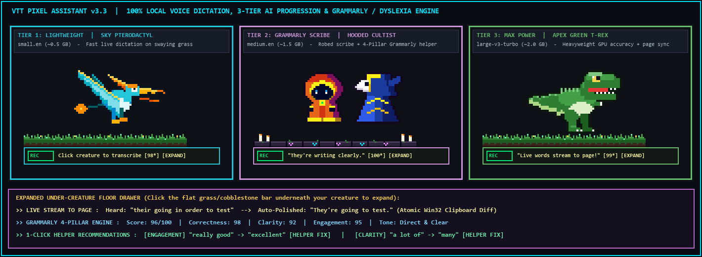
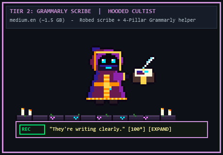
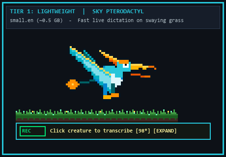
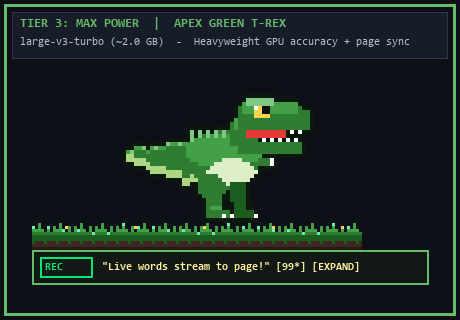

# VTT Pixel Assistant v3.5 — 100% Local Voice Dictation, Pure Text Review (No-VTT), 4-Tier AI Progression & Grammarly Companion



**VTT Pixel Assistant** is a 100% local, privacy-first desktop voice-to-text (VTT) and Grammarly-style dyslexia writing companion built with **Flutter Desktop (Win32 Transparent Click-Through Overlay)** and a **CUDA-accelerated Python FastAPI + `faster-whisper` backend**.

Instead of a bulky floating HUD box above your companion, the assistant's UI lives **underneath the creature as a Living Pixel Terrain Floor** — starting as a compact, flat grass or cobblestone platform (`Click creature to transcribe` or `[🔍 REVIEW]`) that expands on click to reveal live streaming transcription, pure screen-text review without transcription, clickable word-choice exploration, and 1-click Grammarly helper recommendations.

---

## 🦖 The 4-Option Mode & Whisper AI Model Progression

Each pixel-art mode represents a distinct tier of local writing or speech-to-text power, standing on its own themed terrain floor:

| Tier | Companion & Terrain | Local Model | VRAM Footprint | Purpose & Progression Role |
| :--- | :--- | :--- | :--- | :--- |
| **Tier 0: Pure Text Review (`T0: REVIEW`)** |  | `No-VTT (Review Only)` | `0.0 GB VRAM` | **Pure Current-Text Reviewer (No Transcription)**: Runs with **zero speech model loaded and microphone off**. Click the creature or `[🔍 REVIEW TEXT]` to capture your current text box or highlighted text on screen and get clickable word-choice swaps, sound-alikes, and 1-click sentence rewrites. |
| **Tier 1: Lightweight Speed (`T1: PTERO`)** |  | `small.en` (`int8_float16`) | `~0.5 GB VRAM` | **Agile & Ultra-Low Resource**: Ideal when gaming or running heavy GPU workloads while still wanting instant everyday voice dictation on a swaying prehistoric grass floor. |
| **Tier 2: Grammarly Scribe (`T2: CULTIST`)** |  | `medium.en` (`int8_float16`) | `~1.5 GB VRAM` | **Humanoid Robed Scribe (`[ROBE: RED]` Gungeon / `[ROBE: BLUE]` Terraria)**: A hooded arcane scribe with a levitating quill & grimoire standing on a candle-lit cobblestone altar — balanced speech recognition paired with the 4-Pillar Grammarly & Dyslexia mentor. |
| **Tier 3: Apex Powerhouse (`T3: T-REX`)** |  | `large-v3-turbo` (`int8_float16`) | `~2.0 GB VRAM` | **Maximum Speech Accuracy**: Heavyweight GPU transcription engine for technical vocabulary, complex phrasing, and long-form dictation on lush prehistoric fern turf. |

---

## ✨ Key Architecture & Features

### 1. Under-Creature Living Terrain Floor (Compact Flat Bar → Expandable Drawer)
- **Living Pixel Artwork (`110x10` Grid)**:
  - **Prehistoric Grass & Fern Turf** (`Tier 1 Pterodactyl` & `Tier 3 Green T-Rex`): Multi-shade swaying green grass blades, fern fronds, wildflowers, and rich pixel soil.
  - **Arcane Cobblestone & Candle Altar** (`Tier 2 Hooded Cultist`): Carved stone flagstones, moss, pulsing runes, and flickering wax candles.
- **Pacing On Its Platform**: When roaming is enabled, your companion walks back and forth **across the width of its terrain floor box** rather than wandering off into empty screen space.
- **Flat by Default, Expandable on Click**:
  - **Collapsed Flat Mode**: Sits as a sleek strip underneath the creature's feet (`[● REC] TIER X • Click creature to transcribe [98★] [▼ EXPAND]`).
  - **Expanded Mode**: Clicking the creature or the flat floor expands the drawer downward to show the **3-Tier Selector**, **Live Voice Stream (`Heard` → `Polished Yellow Text`)**, **Grammarly 0–100 Writing Score**, and **1-Click Helper Recommendation Cards**.

### 2. Local Grammarly 4-Pillar & Dyslexia Engine (`backend/dyslexia_grammar.py`)
Runs 100% locally in `< 1 ms` with zero cloud calls and zero extra VRAM:
1. **Correctness (Dyslexia & Homophones)**:
   - Context-aware disambiguation for `their / there / they're`, `your / you're`, `to / too / two`, `its / it's`, `then / than`, `affect / effect`, `lose / loose`, `weather / whether`, `passed / past`, `aloud / allowed`, `piece / peace`, and `could of → could have`.
   - 120+ dyslexia letter-reversal, transposition, and phonetic spelling fixes.
2. **Clarity & Conciseness**:
   - Automatically simplifies wordy spoken phrases (`"in order to"` → `"to"`, `"due to the fact that"` → `"because"`, `"at this point in time"` → `"now"`, `"in the event that"` → `"if"`, `"on a daily basis"` → `"daily"`).
3. **Engagement & Vocabulary**:
   - Identifies weak intensifiers and overused words (`"really good"` → `"excellent"`, `"very important"` → `"crucial"`, `"a lot of"` → `"many"`, `"make sure"` → `"ensure"`).
4. **Delivery & Tone**:
   - Detects tone (`Direct & Clear`, `Warm & Positive`, `Analytical & Formal`, `Inquisitive`), supports `Clear`, `Formal`, and `Casual` rewrite modes, and strips spoken fillers (`um`, `uh`, `er`) and word/phrase stutters.
5. **Interactive 1-Click Helper Fixes (`POST /apply_recommendation`)**:
   - Click `[HELPER FIX]` on any recommendation card in the expanded floor box and your pixel helper immediately performs an in-place replacement both in the live preview and directly inside your external document!

### 3. Smart Typo Fixer & Live Clean (`backend/typo_fixer.py`, `backend/live_cleaner.py`)
- **Any wrong, missing, extra or swapped letter**: beyond the fixed spelling list, every typed word is checked with Windows' built-in spell checker (100% local) and candidates are re-ranked with a keyboard-aware edit distance, so `wron` → `wrong`, `lewtters` → `letters`, `gfo` → `go`, `Functinality` → `Functionality`.
- **Only confident fixes are automatic**: when two words are equally likely (`cnt` → cut / cant / cent) the word is left alone, underlined red, and offered as click-to-pick choices with a `✓ KEEP` button that adds it to your personal dictionary (`backend/user_settings.json`).
- **Clean as you go**:
  - The Writing Studio scratchpad cleans each word the moment you finish it, without moving your caret or touching the word you are still typing.
  - `⚡ LIVE CLEAN` (off by default, remembered once switched on) does the same in *any* app: a keyboard listener keeps the last few words in memory only and fixes a word when you press space or punctuation. **Backspace right after a fix undoes it** and stops that word being changed again. It never fires on Enter/Tab, and skips code editors, terminals and password managers.
- Each fix pops a `✔ teh → the` toast over the creature and the corrected word flashes green in the live preview.

### 4. Atomic Point-A to Point-B External Window Typing (`windows/runner/flutter_window.cpp`)
- **Zero Focus Stealing (`WS_EX_NOACTIVATE`)**: Clicking the creature or HUD buttons never steals keyboard focus from Notepad, Word, VS Code, or your browser.
- **WinUI 3 / Notepad Safe Atomic Sync (`TypeInPlace`)**: Uses mathematical edit coalescing in Python + native C++ `VK_BACK` mini-batches + `CF_UNICODETEXT` Clipboard `Ctrl+V` synchronization so what you see in the yellow live preview is transferred identically to your active page.

---

## 🚀 Quick Start

```powershell
# 1. Run backend unit tests (24 tests)
pytest tests/test_backend.py -v

# 2. Run Flutter static analysis & widget tests
flutter analyze
flutter test

# 3. Build and launch the Windows desktop overlay
flutter build windows
.\run_assistant.bat
```
